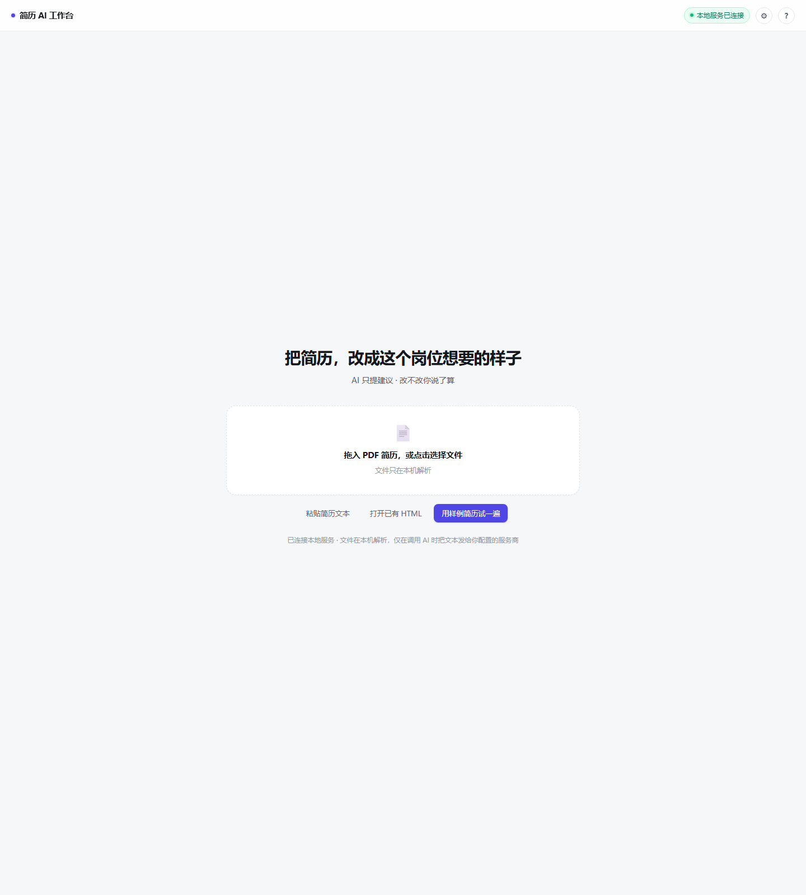
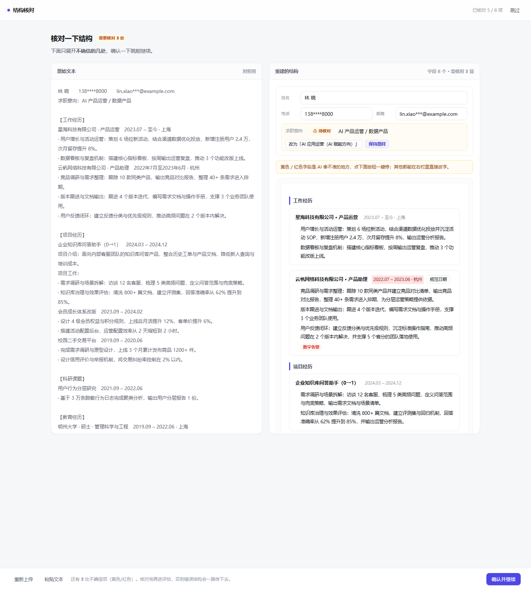
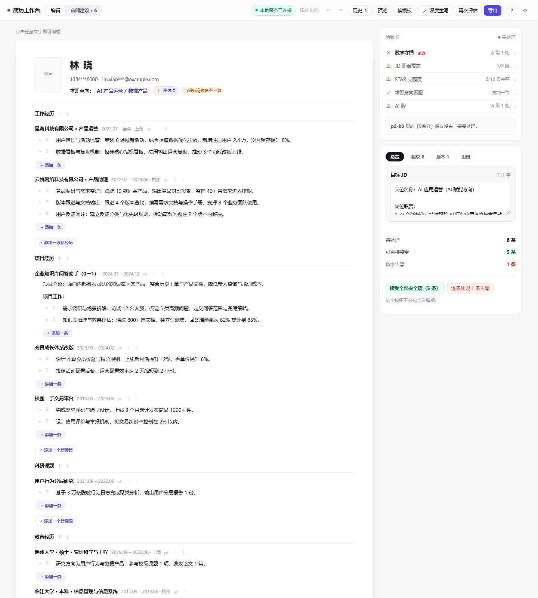
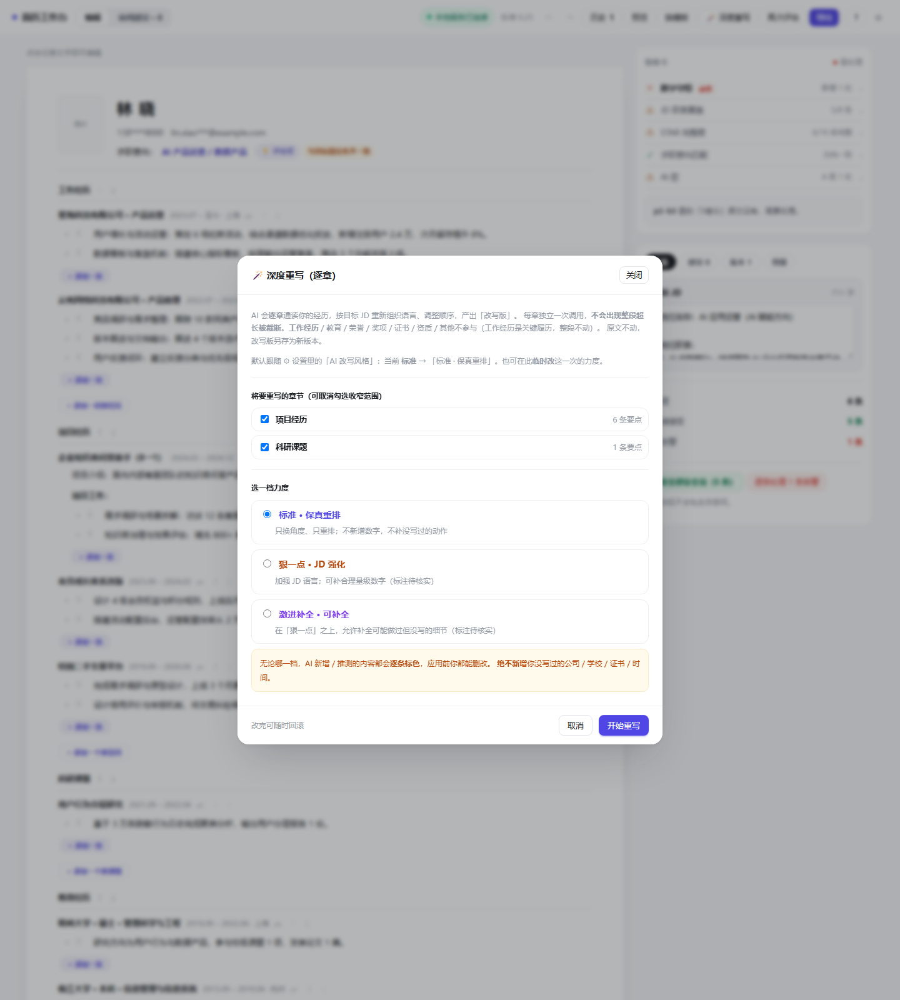
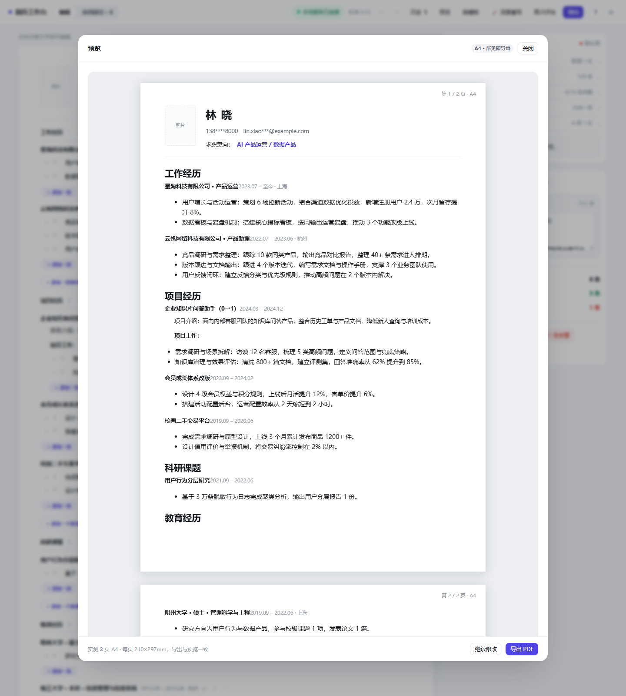

<div align="center">

# 简历 AI 工作台

**把简历改成「这个岗位想要的样子」——AI 只提建议，改不改你说了算。**

本地运行 · 数据不出本机 · 单文件前端 · 服务端零第三方依赖

</div>

---

## 界面预览

> 截图使用内置样例简历，在离线演示模式下拍摄；实际使用时连接本地服务，界面一致。

| 导入 PDF | 结构核对 |
| --- | --- |
|  |  |

| 工作台（编辑模式） | 深度重写（逐章） |
| --- | --- |
|  |  |

| 模板与导出 |
| --- |
|  |

---

## 这是什么

一个跑在你自己电脑上的简历工作台：

```
导入 PDF → 核对结构 → 粘贴 JD → AI 评估 / 改写 → 人工确认 → 导出 PDF
```

它解决的不是「让 AI 替你编一份简历」，而是：

- **把真实经历，用目标岗位听得懂的语言重新讲一遍；**
- **每一条改动都标出来源和风险**，由你决定留不留；
- **简历、JD、API Key 都留在本机**，只有调用 AI 时简历文本才会发给你自己配置的模型服务商。

## 设计原则

### 1. AI 只建议，不自动改
所有 AI 产出都先进入「建议 / 预览」层：逐条建议、改写对比、深度重写结果，都需要你确认后才写回正文。每次应用都会另存版本，可随时回滚。

### 2. 保真边界：允许包装，禁止伪造
- **允许**：换角度、把动作展开成产出物、围绕 JD 命名机制、动词升级；
- **允许但标色**：合理补全、合理量级的数字，必须标成「推断数字 / 推测经历」；
- **硬红线**：不新增没写过的公司、岗位、项目、学校、证书、时间区间。

### 3. 两层守恒护栏
- **数字守恒**：改写文本里出现原文没有的数字 → 本机复核拦截，强制降级为「推断数字」并登记；
- **条目守恒**：模型漏回项目 / 公司 / 要点时 → 自动用原文补回，绝不静默丢内容。

---

## 功能详解

### 1. PDF 导入与结构核对

- **几何取字**：优先用 PyMuPDF 读取每个字符的坐标与字号，恢复行、缩进、项目符号；
- **模型只判结构**：模型负责判断每一行是章节标题、单位、角色、日期还是要点，**不重写一个字**；
- **多级降级**：没有 PyMuPDF → pypdf 文本 + 规则；再不行 → 粘贴文本 / Word；
- **结构核对页**：导入后先确认章节归属、条目层级，再进入工作台。

### 2. 按 JD 逐条评估

- 粘贴目标岗位 JD，AI 先拆解成 4–8 条职责（R1、R2…）；
- 对简历每条要点给出：是否改写、改写稿、命中的 JD 职责、风险标签；
- 标签四色：
  - **真实**：原文事实的换种说法；
  - **换角度**：调整叙述角度 / 突出产出；
  - **推断数字**：原文没有的数字，必须核实；
  - **推测经历**：原文没写、按岗位合理补全的经历，必须核实。
- 右侧验收卡实时汇总：数字守恒、JD 覆盖、STAR 完整度、AI 腔、求职意向。

### 3. 深度重写（逐章）

- **按章节逐章重写**，每章独立一次模型调用，避免整份简历超长输出被截断；
- 可勾选参与重写的章节；**工作经历 / 教育 / 荣誉 / 奖项 / 证书 / 资质 / 其他默认不参与**；
- 三档强度：
  - **标准 · 保真重排**：只换表达与顺序；
  - **大胆 · JD 强化**：围绕 JD 重组叙述；
  - **激进 · 可补全**：允许合理补全，但全部标色；
- 结果按章分组核对：可改文字、改标签、取消某条；确认后一键应用为独立版本；
- **条目守恒安全网**：模型漏回整个项目 / 公司，或漏回某条要点时，自动用原文补回并标注「未改写」。

### 4. 指令式改写（指哪改哪）

- 选中**一条要点 / 一段经历 / 一个章节**；
- 用一句自然语言说要求，例如：
  - 「更偏产品经理视角，突出需求拆解和跨团队协同」
  - 「压缩到 60 字以内，保留量化结果」
  - 「把这三条合并成两条，不要删信息」
- AI 只改这一段，先给「原文 vs 改写」对比；
- 可**接受 / 拒绝 / 再改改**（在上一版基础上继续迭代），确认后才写回。

### 5. 手动编辑

- 正文直接改，`Ctrl+B` 加粗选中文字；
- 要点拖拽排序，或每条右上角 `↑↓` 微调；
- 新增要点、**新增项目 / 课题**、新增章节、删除、跨章节移动；
- 所有操作支持撤销 / 重做。

### 6. 模板与导出

- 内置 **6 套模板 + 5 套配色**，可调字体、行高、字号；
- 自动压页（`zoom` 整体缩放），尽量控制在 1–2 页 A4；
- 导出由**本机浏览器无头渲染** HTML → PDF，全程不上传任何数据。

---

## 推荐使用流程

1. **导入**：上传 PDF，或粘贴文本 / Word；
2. **核对结构**：确认章节与条目归属，改掉解析错位；
3. **贴 JD**：把目标岗位 JD 粘到右侧面板；
4. **逐条评估**：先看每条建议和风险标签，接受有把握的；
5. **深度重写 / 指令改写**：需要整段调整时用深度重写；只想改某一段时用 ✨ 指令改写；
6. **手动收尾**：改错别字、调顺序、加粗关键词、补一条项目；
7. **选模板导出**：挑模板与配色，导出 A4 PDF。

---

## 快速开始

### 环境要求

| 项目 | 要求 |
| --- | --- |
| 操作系统 | Windows（`start.bat` 一键启动）；macOS / Linux 可手动运行 |
| Python | 3.10+ |
| 浏览器 | Chrome / Edge（导出 PDF 需要） |
| 可选 | PyMuPDF（让 PDF 结构解析更准）；pypdf 已随 `libs/` 自带 |

### 方式一：Windows 一键启动

双击 **`start.bat`**。会弹出服务窗口（别关），并自动打开 `http://127.0.0.1:8420/`。

### 方式二：手动启动

```bash
git clone https://github.com/YESOKUUP/resume-ai-workbench.git
cd resume-ai-workbench
python server/app.py
```

然后打开 `http://127.0.0.1:8420/`。

### 配置模型

1. 打开右上角 **⚙ 设置**；
2. 选择服务商（任何 OpenAI 兼容接口）；
3. 填 `Base URL` / `Model` / `API Key`；
4. 保存后点「测试连接」；
5. Key 只写入本机 `config.json`，该文件已在 `.gitignore` 中，不会进仓库。

也可以复制 `config.example.json` 为 `config.json` 后手动填写。

### 支持的模型服务

只要满足以下条件即可：

- 提供 **OpenAI 兼容** 的 `/chat/completions` 接口；
- 支持**流式输出**；
- 能按提示词输出 **NDJSON**（每行一个 JSON 对象）。

常见可选：OpenAI、DeepSeek、智谱 GLM、通义千问、Kimi、Ollama 本地模型等。

---

## 配置项说明

`config.json` 的 `llm` 段：

| 字段 | 作用 |
| --- | --- |
| `provider` | 服务商标识（设置页选择） |
| `base_url` | OpenAI 兼容 API 地址 |
| `model` | 模型名 |
| `api_key` | 密钥，仅存本机 |
| `temperature` | 采样温度 |
| `rewrite_style` | 全局改写风格：`faithful` / `standard` / `bold` / `aggressive` |
| `pure_rule` | 只跑本机规则体检，不调用 AI |
| `timeout` | 请求超时（秒） |
| `price_in` / `price_out` | 可选：输入 / 输出计价 |
| `currency` | 货币符号 |

---

## 数据与隐私

- 简历、JD、导出文件、日志都只在本机；
- API Key 只写入本机 `config.json`，前端永远拿不到明文；
- 只有调用 AI 时，简历文本才会发给你**自己配置**的服务商；
- 仓库已通过 `.gitignore` 排除：
  - `config.json`（含 Key）
  - `export/`（导出文件，可能含个人信息）
  - `logs/`、`usage.json`（本机使用记录）
  - `temp/`（测试产物 / 浏览器缓存）
- 分享代码或换机器前，务必确认不要提交 `config.json`。

---

## 项目结构

```
resume-ai-workbench/
├── index.html          # 单文件前端（界面 + 交互 + 模板预览）
├── server/             # 本地服务（纯 Python 标准库）
│   ├── app.py          # HTTP / SSE / API 路由
│   ├── llm.py          # OpenAI 兼容客户端 + NDJSON 流式解析
│   ├── prompts.py      # 提示词与改写档位（唯一真源）
│   ├── rules.py        # 数字守恒 / 规则体检
│   ├── docio.py        # PDF / Word 读写
│   └── store.py        # 配置 / 日志 / 用量
├── tools/              # PDF 结构解析、模板渲染、命令行工具
│   ├── pdfstruct.py    # 几何取字 + 结构识别引擎
│   ├── templates.py    # 6 套模板 + 5 套配色
│   ├── render.py       # 模板渲染 / 批量出稿
│   └── pdf2html.py     # 独立的 PDF → HTML 工具
├── libs/pypdf/         # 自带 pypdf，免 pip install
├── docs/
│   ├── GUIDE.md        # 完整使用 / 开发手册
│   └── images/         # 界面截图
├── config.example.json # 配置模板（复制为 config.json 后填 Key）
├── start.bat
└── README.md
```

---

## 技术实现

### 前端：单文件、零构建
全部界面、状态、模板预览都在一个 `index.html` 里，没有 npm、没有打包步骤。双击即可运行，也方便二次修改。

### 服务端：标准库 + SSE
用 Python 标准库 `http.server` 起服务，AI 调用通过 **SSE** 流式转发给前端。不引入 Flask / FastAPI，减少安装负担。

### PDF 解析：几何取字 + 模型判构
- PyMuPDF 拿到字符坐标、字号、页面位置；
- 用几何规则恢复行、缩进、项目符号、章节标题；
- 模型只负责「这一行是什么角色 / 属于哪一级」，不参与文字生成；
- 解析失败时逐级降级，不会卡死在导入页。

### NDJSON 流式解析
模型输出采用 NDJSON（每行一个完整 JSON）。解析器按**大括号配平**扫描，而不是按行切分——即使模型把对象美化输出成多行，也能正确拼回。

### 本机护栏
- **数字守恒**：`rules.number_diff()` 对比原文与改写稿的数字集合；
- **条目守恒**：块级按 heading 认回，要点级按短标签 / 字符二元组覆盖率判断；
- 所有护栏都在本机执行，不依赖模型自觉。

### 模板与导出
模板用 CSS 变量管理配色与排版；渲染后用本机 Chrome / Edge 无头模式导出 A4 PDF，自动压页由 `zoom` 控制。

---

## 常见问题

**Q：端口 8420 被占用怎么办？**
设置环境变量 `RW_PORT` 后重启，例如 `set RW_PORT=8430`。

**Q：PDF 解析不准确？**
安装 PyMuPDF 后重启服务，结构识别会明显变好。没有也能用，只是复杂版式容易错位。

**Q：模型输出被截断 / 提示格式不对？**
换输出上限更大的模型；如果模型有「思考 / 推理模式」，建议关闭。原始输出会存到 `logs/` 便于排查。

**Q：API Key 存在哪？会上传吗？**
只存在本机 `config.json`，不会上传。前端只拿到「是否已设置」和掩码提示。

**Q：可以完全离线用吗？**
可以导入、编辑、排版、导出；AI 相关功能需要你配置的模型服务（也可以是本机 Ollama）。

**Q：导出 PDF 需要装什么？**
需要本机安装 Chrome 或 Edge，服务会调用无头模式渲染。

**Q：我的简历数据会被收集吗？**
不会。仓库里没有任何上报 / 统计代码；只有调用 AI 时文本会发给你配置的服务商。

**Q：怎么换模板 / 配色？**
导出前在模板选择器里切换；也可以在 `tools/templates.py` 里加自己的模板。

**Q：更多细节在哪？**
见 [docs/GUIDE.md](docs/GUIDE.md)——完整使用手册、PDF 解析细节、提示词设计与测试说明。

---

## 开发与测试

发布版仓库只包含运行所需源码，不包含 `temp/` 下的测试脚本与样例数据。
完整开发版包含 30+ 套自动化测试（mock 上游 LLM，无需真实 Key），覆盖：

- PDF 结构解析与层级还原；
- 数字守恒 / 条目守恒护栏；
- 逐条评估、深度重写、指令改写；
- 前端编辑、模板渲染、PDF 导出；
- 服务端 SSE 协议与降级链路。

---

## 反馈

个人项目，持续迭代中。欢迎通过 issue 反馈问题或建议。
